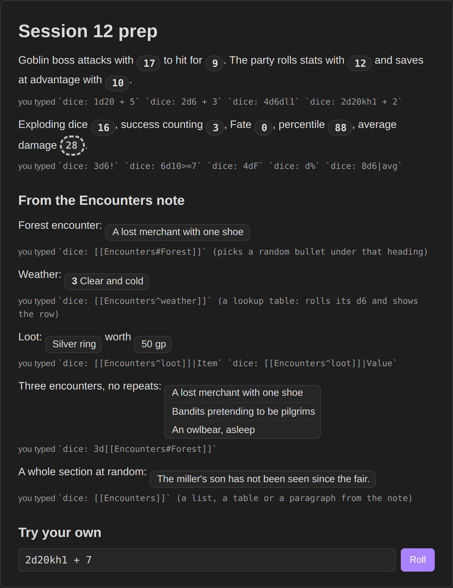

# Dice Tray

Roll dice inside your notes. Write `` `dice: 2d20kh1 + 5` `` and the note shows the result as a small chip you can click to roll again. Hover it to see every die.

It reads the same notation as the Dice Roller plugin's `dice:` blocks, so notes written for that plugin keep working here.



**Try it in your browser** before installing: https://bulkhead.bananafest-destiny.com/press/dice-tray/ runs the real plugin code over a sample note.

## Writing a roll

Inline, anywhere in a note:

```
`dice: 3d6 + 2`
`dice: d20`
`dice: (1d4 + 2) * 2`
```

Or a block with one roll per line:

````
```dice
2d20kh1 + 5
8d6
```
````

There is also a command, **Roll dice**, that opens a small roller and remembers your last few rolls.

## Notation

| Write | Meaning |
| --- | --- |
| `3d6`, `d20`, `d%` | three six-siders, one d20, one d100 |
| `+ - * / ^ ( )` | arithmetic, with the usual precedence |
| `2d20kh1`, `2d20kl1`, `4d6k3` | keep highest or lowest (`k` alone keeps the highest one) |
| `4d6dl1`, `4d6dh1`, `4d6d1` | drop lowest or highest |
| `1d6!`, `1d6!3`, `1d6!i` | explode on the top face: once, three times, until it stops |
| `1d6!!` | compound: the exploded dice add into one die |
| `1d6!>4` | explode on a condition |
| `4d6r`, `4d6r2`, `4d6ri`, `4d6r<3` | reroll the bottom face once, twice, until it stops, or on a condition |
| `5d10>=8`, `3d6=6`, `3d6=!6` | count the dice that pass instead of adding them |
| `4dF` | Fudge or Fate dice, -1 to 1 |
| `1d66%` | two d6 read as tens and ones |
| `3d[2,5]` | a die with faces from 2 to 5 |
| `8d6s`, `8d6sd`, `3d6u` | sort ascending, sort descending, reroll duplicates |
| `1dS` | Fantasy AGE: three d6, the last one the stunt die; doubles show the stunt points |
| `1d20 + dex` | a number named in the note: frontmatter (`dex: 3`) or a field line (`dex:: 3`, `[dex:: 3]`) |
| `2g1y2p`, `3g4d1s` | Genesys and Star Wars narrative dice (see below) |

Flags go after a `|`: `` `dice: 3d6|avg` `` shows the average, `|noform` hides the formula, `|form` shows it, `|nodice` hides the icon, `|none` shows nothing until clicked, `|text(Roll me)` shows a label instead of the number.

A lone d20 glows green on a natural 20 and red on a natural 1.

## Narrative dice

Letters name Genesys and Star Wars dice, each with an optional count: `g` or `a` ability, `y` proficiency, `d` difficulty, `r` or `c` challenge, `b` boost, `s` or `k` setback, `w` or `f` force. `p` is difficulty, or proficiency when the pool uses `a`, `c` or `d`. The chip shows the net result (`2 successes, 1 threat, 1 triumph`), and hovering lists each die.

## Into your session log

With [Session Log](https://github.com/walkertbrown/session-log) installed, a roll you click lands in your session log with the dice it showed:

```
- 20:16 Rolled 1d20 + dex -> [17] + 3 -> 20
- 20:17 Rolled [[Encounters#Forest]]: Wolves
```

Only rolls you make count: a click on a roll, or the **Roll dice** command. The rolls a note makes as it opens are not logged.

## Rolling on notes

Point a roll at a note and it picks from what is inside:

| Write | Picks |
| --- | --- |
| `` `dice: [[Encounters]]` `` | a random section (paragraph, list, table…) of that note |
| `` `dice: 3d[[Encounters]]` `` | three different sections |
| `` `dice: [[Encounters#Forest]]` `` | a section under that heading |
| `` `dice: [[Loot^gems]]` `` | a random row of the table (or item of the list) with block id `^gems` |
| `` `dice: [[Loot^gems]]\|Item` `` | just the `Item` column of that row |
| `` `dice: [[Rumours]]\|line` `` | a random line |

A table whose first column holds dice ranges is a lookup table: name the dice in its header and the roll lands on the matching row.

```
| d20  | Weather        |
| ---- | -------------- |
| 1-5  | Rain           |
| 6-15 | Clear          |
| 16-20 | Fog           |
^weather
```

`` `dice: [[Tables^weather]]` `` rolls a d20 and shows that row. Results render as markdown; add `|norender` for plain text.

## Not yet

Rolling a random note by tag (`dice: #tag`), `dice-mod:` writing results into the note, saved results, and the Dice View side panel are not in this release. If you use those, keep Dice Roller installed for now; the two plugins can run side by side.

## Privacy

Dice Tray does not use the network, has no accounts, collects nothing and sends nothing. Settings are stored in your vault like any plugin's.

## Install

From Obsidian: Settings → Community plugins → Browse → search "Dice Tray".

By hand: copy `main.js`, `manifest.json` and `styles.css` from the latest release into `<your vault>/.obsidian/plugins/dice-tray/`, then enable it under Community plugins.

## Also from this maker

- [Quick Initiative](https://github.com/walkertbrown/quick-initiative): a light initiative tracker that keeps the whole fight as plain text in your note and reads Fantasy Statblocks creature notes.
- [Session Log](https://github.com/walkertbrown/session-log): a quick log for game night that writes timestamped lines into your session note.
- [Encounter Builder](https://github.com/walkertbrown/encounter-builder): plan fights against the 5E XP budget, then start them in Quick Initiative.
- [Tabletop Clocks](https://github.com/walkertbrown/tabletop-clocks): segmented clocks for danger, plans and factions, ticked with a click and kept as text in the note.

## Source

https://github.com/walkertbrown/dice-tray

## Build

```
npm install
npm test
npm run build
```

MIT licensed.
